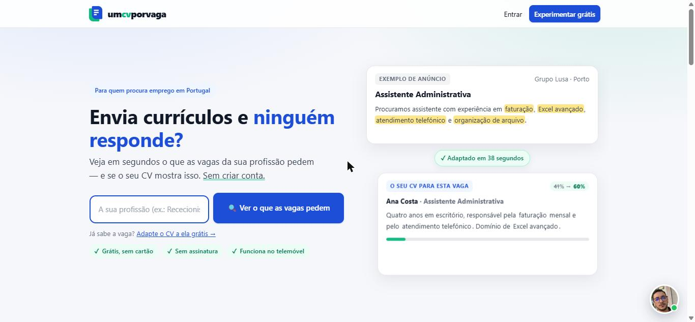
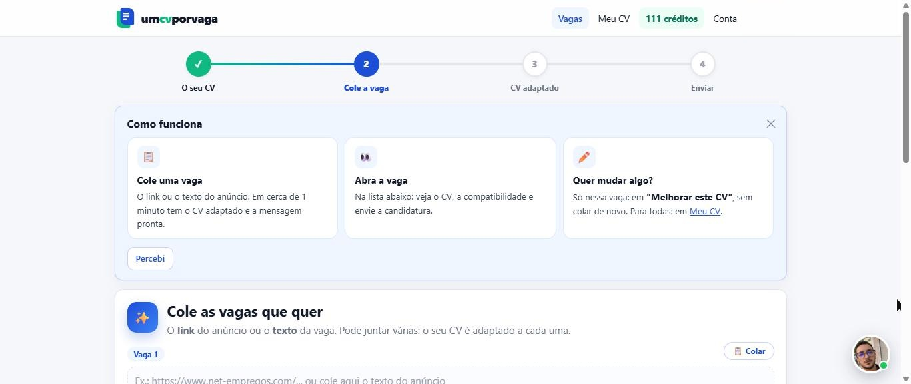
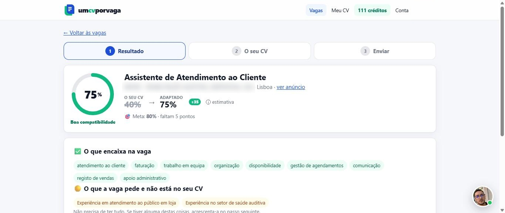

  

# 📄 Um CV por Vaga

**Plataforma SaaS que adapta o CV de cada candidato a uma vaga específica com IA, sem inventar dados, e envia a candidatura.**

🔗 **Em produção:** [umcvporvaga.pt](https://umcvporvaga.pt)

  

> O código-fonte é privado, porque se trata de um produto comercial em funcionamento. Este repositório apresenta o projeto, as funcionalidades e as decisões técnicas.

---

## 💡 O problema

Quem procura emprego costuma enviar o mesmo CV para todas as vagas. Os recrutadores, e os filtros automáticos de candidaturas, notam a falta de correspondência entre o CV e o anúncio.

## ✅ A solução

O utilizador carrega o seu CV uma vez. Depois, para cada vaga, cola o anúncio e, em cerca de um minuto, recebe:

- uma análise de quanto o seu perfil encaixa na vaga e do que falta;
- o CV reescrito para essa vaga, usando **apenas** a experiência real do candidato;
- a candidatura pronta a enviar, por e-mail ou pelo próprio Gmail do utilizador.

---

## ✨ Funcionalidades

- **Adaptação do CV com IA** (Gemini), com regras explícitas para não inventar experiência, formação ou competências.
- **Login com Google (OAuth)** e envio de candidaturas através da **Gmail API** do próprio utilizador (token de acesso guardado cifrado).
- **E-mail transacional com domínio autenticado** (DKIM e DMARC) e encaminhamento automático das respostas dos recrutadores para o candidato.
- **Pagamentos com Stripe** (cartão, MB WAY, Apple Pay e Google Pay) e sistema de créditos.
- **Painel de administração** com utilizadores, estatísticas de visitas e controlo do custo da IA por pedido.
- **E-mails de ajuda automáticos** para quem se regista mas não chega a usar a plataforma.

  
  

## 🛠️ Stack técnica

| Camada | Tecnologia |
|---|---|
| Backend | PHP |
| Frontend | HTML, CSS e JavaScript |
| Base de dados | MySQL |
| IA | Gemini API, com fornecedor alternativo em caso de falha |
| Autenticação | Google OAuth |
| E-mail | Gmail API e Brevo (DKIM/DMARC) |
| Pagamentos | Stripe (Checkout e webhooks) |
| Servidor | Linux (Hostinger), publicação via SSH |

  

## 🧪 Como é testado e publicado

  

Cada atualização passa por um script de publicação que:

1. corre a suíte de testes automáticos numa cópia de testes no servidor;
2. só continua se todos os testes passarem;
3. faz cópia de segurança, sincroniza os ficheiros e aplica as migrações da base de dados;
4. verifica por HTTP que o site responde corretamente.

Além disso, cada funcionalidade é testada manualmente na aplicação antes e depois de publicada.

## 👤 O meu papel

Projeto pessoal, desenvolvido com o **Claude Code** como assistente de programação. Defini as funcionalidades, analisei e modifiquei o código, geri a base de dados, testei cada parte e corrigi os erros até tudo funcionar em produção.

**O que mais aprendi:** a parte difícil não é a IA, é tudo à volta dela. Autenticação, pagamentos e e-mails que não caem no spam deram mais trabalho do que o próprio "cérebro" da aplicação.

---

📫 [LinkedIn](https://www.linkedin.com/in/nicolas-kaiky) · 📍 Lisboa, Portugal
